# LMS Webpage Screenshots

Captured on 24 November 2026 from the frontend demo. All records are fictional. Images show UI states at different points in the sample examination workflow; they do not imply live authentication or a connected backend.

## Gallery

### Entry page

Choose a user workspace from index.html.

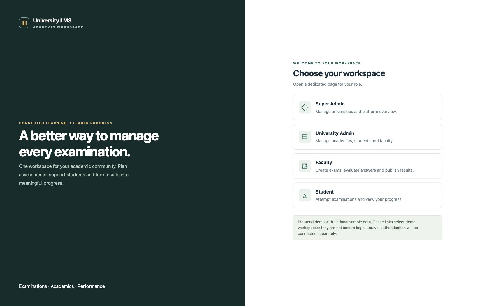

### Super Admin dashboard

University registry and platform summary.

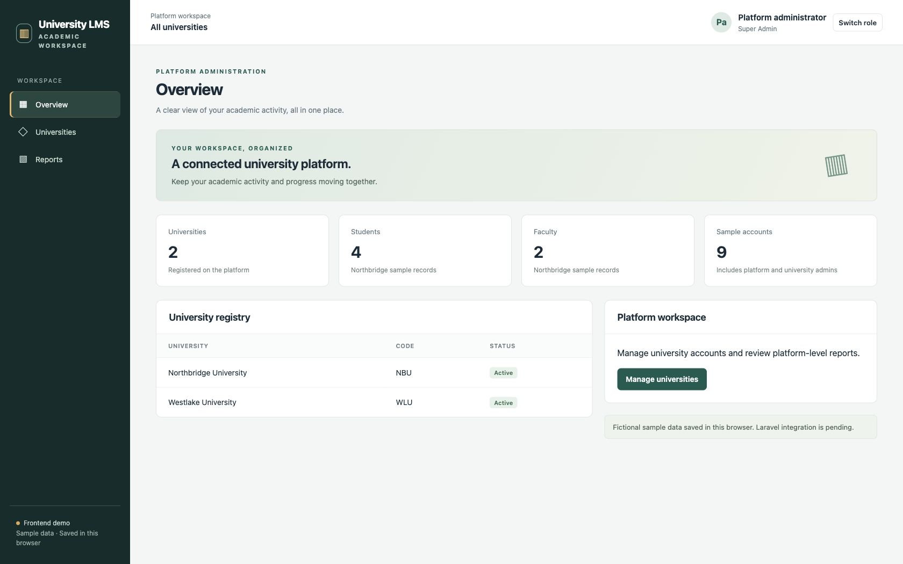

### University Admin dashboard

Academic records, examination overview and university performance.

### Faculty dashboard

Assigned subjects, examinations and pending evaluation overview.

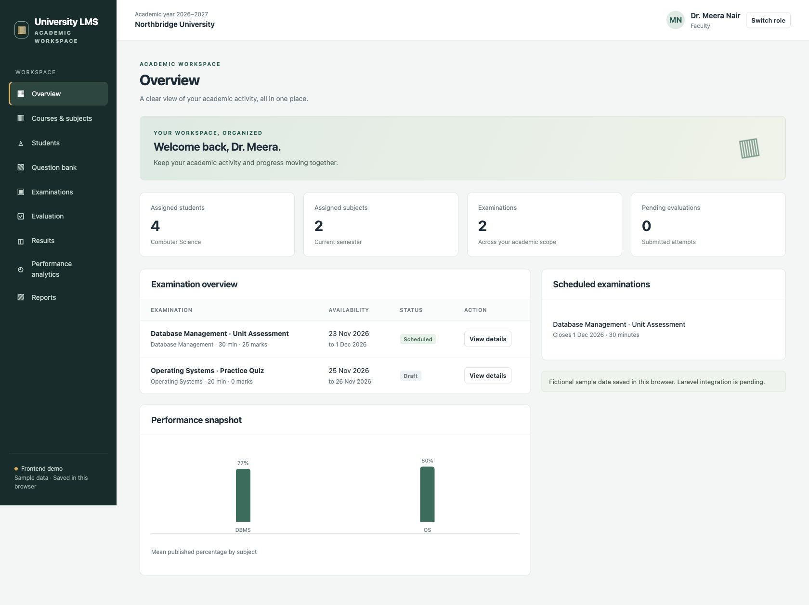

### Student dashboard

Assigned examinations, published results and personal progress.

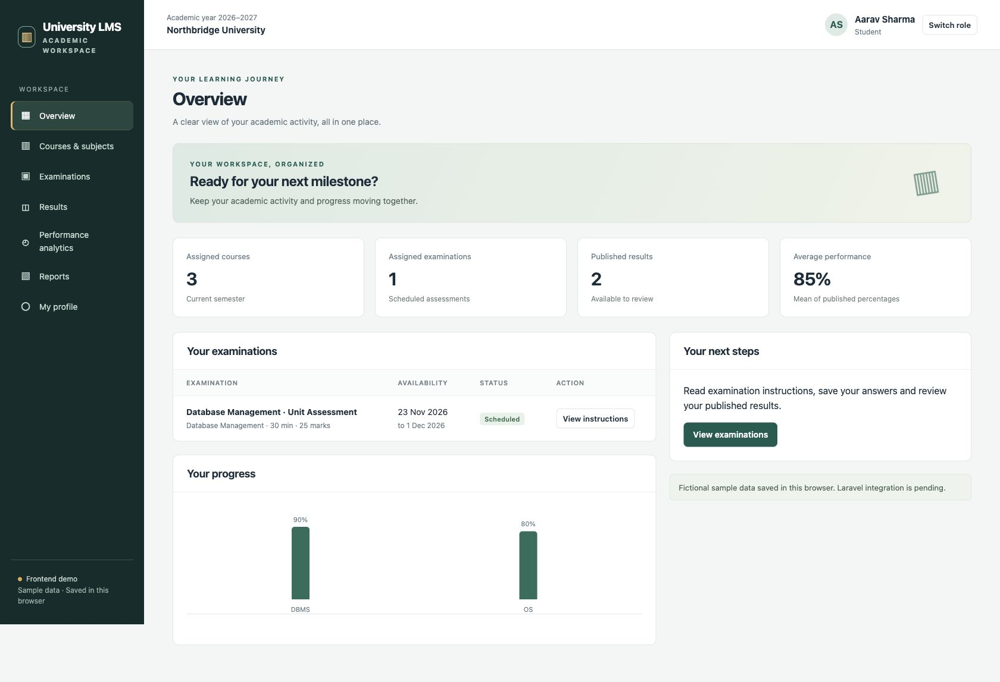

### Faculty question bank

Question types, subjects, marks and difficulty.

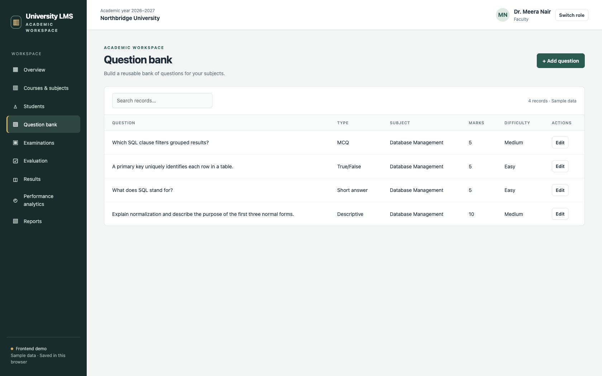

### Create examination

Faculty form preview showing exam settings, question selection and recipients. The form scrolls to additional controls.

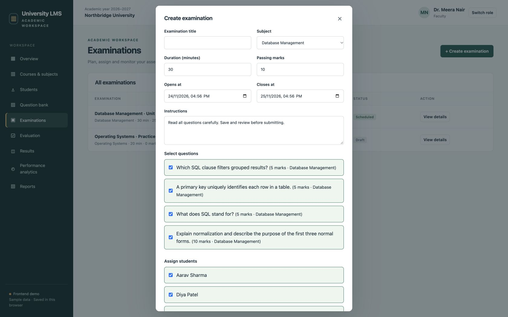

### Student examination

Question navigation, answer selection and the browser demo timer.

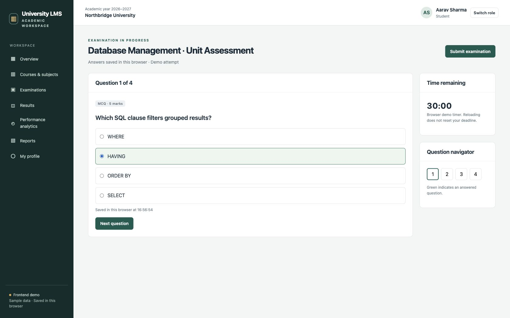

### Faculty evaluation

Submitted answers, objective marks and manual marking fields. The dialog scrolls to additional controls.

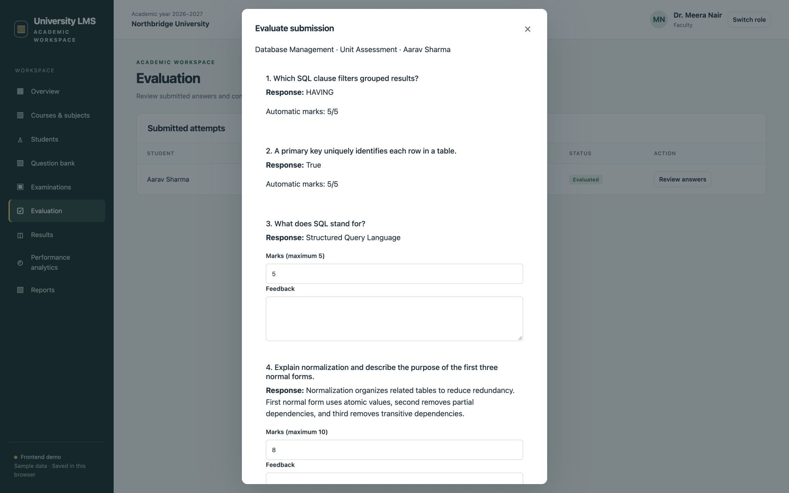

### Student results

Published examination results visible to the student.

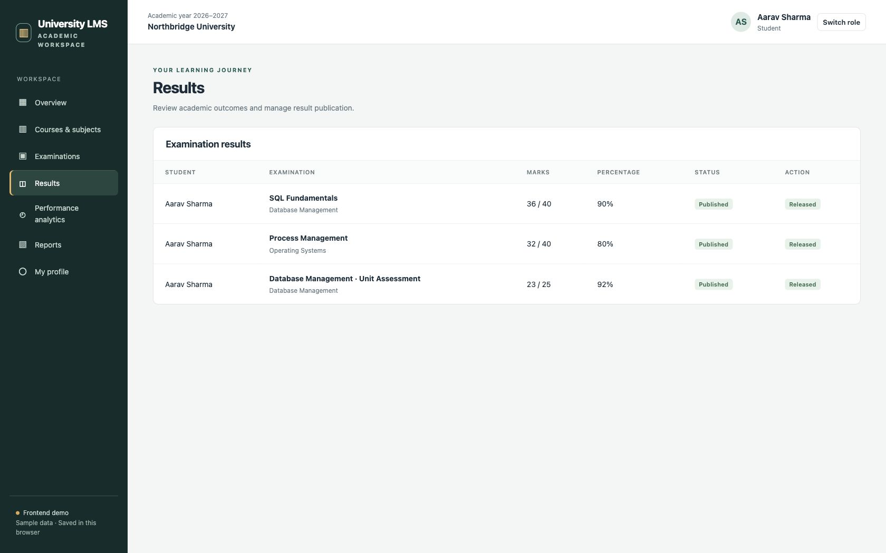

### Student performance analytics

Published score summaries and subject comparisons.

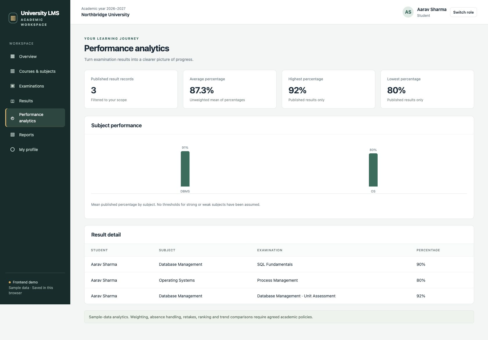

### Student reports

Report filters, result details and export controls.

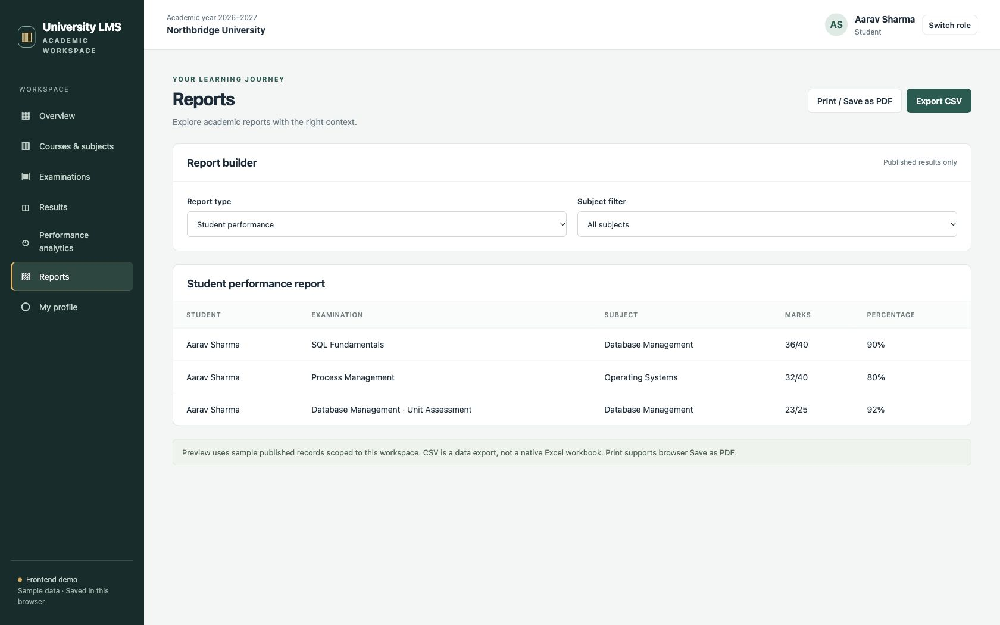
